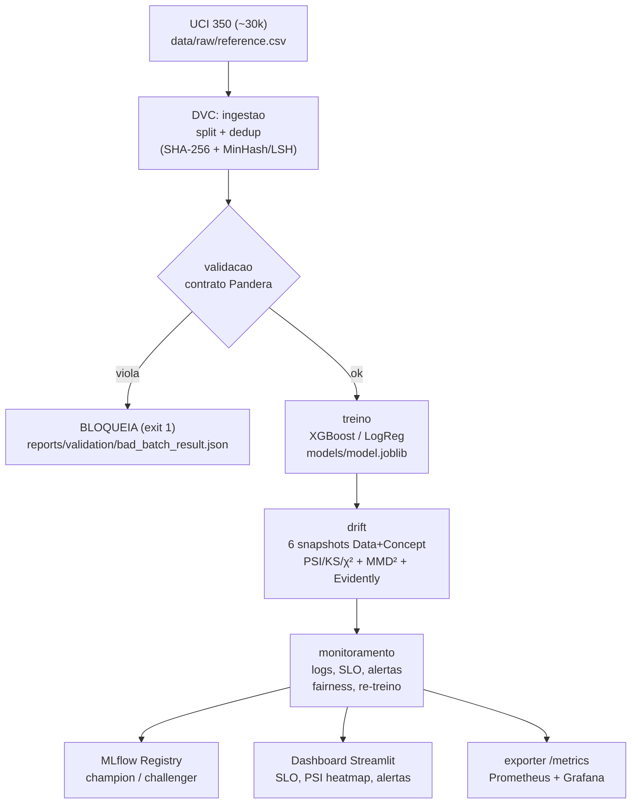

# Tech Challenge Fase 4 — Observabilidade, Drift e Governança

Camada de **sustentação e confiabilidade** para um modelo de *Credit Scoring* em produção. O projeto
intercepta dados ruins com **data contracts**, simula a passagem do tempo (**Data + Concept Drift**),
detecta a degradação com testes estatísticos (**PSI-first** / Kolmogorov-Smirnov / χ²) e multivariados
(**MMD² / Energy**), gera relatório **Evidently AI**, expõe a saúde do pipeline em um **dashboard
Streamlit** e no **`/metrics`** (Prometheus + Grafana), versiona modelos no **MLflow Registry** e
documenta governança (**LGPD**), análise **causal** e **fairness** — tudo com pipeline reprodutível em
**DVC** e **CI/CD** (GitHub Actions).

> Projeto do grupo **G13-MLE** para o Tech Challenge da Fase 04 (PÓS TECH FIAP).
> Dataset de referência: **UCI Default of Credit Card Clients** (ID 350, Taiwan, ~30k clientes) —
> com **fallback sintético** para execução offline/CI. Referência e produção **nunca se misturam**.

---

## Sumário

- [Visão geral](#visão-geral)
- [Arquitetura](#arquitetura)
- [Entregáveis por etapa](#entregáveis-por-etapa)
- [Critérios de avaliação](#critérios-de-avaliação)
- [Bibliotecas requeridas](#bibliotecas-requeridas)
- [Estrutura do projeto](#estrutura-do-projeto)
- [Pré-requisitos](#pré-requisitos)
- [Setup rápido](#setup-rápido)
- [Como executar o pipeline](#como-executar-o-pipeline)
- [Decisão arquitetural](#decisão-arquitetural)
- [Etapa 1 — Contratos de dados](#etapa-1--contratos-de-dados)
- [Etapa 2 — Detecção de drift](#etapa-2--detecção-de-drift)
- [Etapa 3 — Observabilidade](#etapa-3--observabilidade)
- [Etapa 4 — Governança e LGPD](#etapa-4--governança-e-lgpd)
- [Model Card](#model-card)
- [DPIA](#dpia-resumo)
- [Análise causal](#análise-causal)
- [Métricas de saúde](#métricas-de-saúde)
- [CI/CD](#cicd)
- [Histórico de commits](#histórico-de-commits)
- [Docker](#docker)
- [Hiperparâmetros](#hiperparâmetros)
- [Testes e lint](#testes-e-lint)
- [Dataset](#dataset)
- [Vídeo STAR](#vídeo-star)
- [Créditos](#créditos)
- [Licença](#licença)

## Visão geral

| Item | Valor |
|---|---|
| Problema | Degradação **silenciosa** de um classificador de crédito sob mudanças econômicas (inflação, novos perfis) |
| Dataset | [UCI Default of Credit Card Clients](https://archive.ics.uci.edu/dataset/350/default+of+credit+card+clients) (ID 350, ~30k) + fallback sintético offline/CI |
| Modelo | XGBoost (fallback LogisticRegression), split determinístico 80/20, dedup **antes** do split |
| Métricas | ROC-AUC ~0.761 (teste); Precision 0.693; Recall 0.322; Brier 0.138 (calibração por bin) |
| Drift | **PSI** (decisão primária) + KS/χ² com FDR-BH/Bonferroni + **MMD²/Energy** + Evidently |
| Observabilidade | Logs JSON-lines (`run_id`/`trace_id`), SLO/Error Budget, alertas anti-fadiga, MLflow, dashboard, `/metrics` |
| Governança | LGPD/PII, Privacy by Design (7 princípios), fairness (disparate impact / equal opportunity), DAG causal, Model Card/DPIA |
| Pipeline | DVC (5 stages: `ingestao → validacao → treino → drift → monitoramento`) |
| Tracking | MLflow Registry (aliases `champion` / `challenger`) |
| CI/CD | GitHub Actions (lint + test + contract-gate + drift-gate + docker-build) |
| Container | Docker multi-stage (`python:3.12-slim`), compose com perfis (`train`, `mlflow`, `dashboard`, `monitoring`) |
| Build | uv + `pyproject.toml` com deps prod/dev separadas |
| Lint | ruff + pre-commit |
| Testes | pytest (61 testes) |

## Arquitetura

Pipeline DVC com estágios em português: `ingestao → validacao → treino → drift → monitoramento`.



Design patterns aplicados:

- **Factory** — `src/model/factory.py` instancia o classificador por nome (`xgboost`, `logistic_regression`).
- **Strategy/Registry** — hiperparâmetros em `configs/params.yaml`; MLflow com aliases `champion`/`challenger`.
- **Collector (proxy)** — `src/observability/exporter.py` lê `reports/**/*.json` e `logs/` a cada *scrape*.
- **Atomic file writes** — todos os artefatos usam write-to-temp-then-rename (`src/core/dataset.py`).

## Entregáveis por etapa

| Etapa | Requisito do edital | Status | Localização |
|---|---|---|---|
| 1 | Data contract (Pandera) que **bloqueia** lotes inválidos | ✔ Concluído | `src/contracts/schema.py`, `src/contracts/validate.py` (exit 1) |
| 1 | Qualidade de dados (dimensões, dedup, missingness, outliers, profiling) | ✔ Concluído | `src/data/`, `reports/validation/result.json`, `reports/validation/profile.html` |
| 1 | Modelo baseline treinado | ✔ Concluído | `src/model/train.py`, `models/model.joblib`, `reports/train_metrics.json` |
| 2 | Simulação de Data + Concept Drift em snapshots mensais | ✔ Concluído | `src/drift/simulate.py`, `src/drift/concept.py`, `data/production/` |
| 2 | Detecção PSI-first + KS/χ² (com correção) + multivariado (MMD²/Energy) | ✔ Concluído | `src/drift/stats.py`, `src/drift/multivariate.py`, `reports/drift/statistical_report.json` |
| 2 | Relatório Evidently AI | ✔ Concluído | `src/drift/detect.py`, `reports/drift/drift_report.html` |
| 3 | Logs centralizados e correlacionados (`run_id`/`trace_id`) | ✔ Concluído | `src/observability/logging.py`, `logs/pipeline.ndjson` |
| 3 | Métricas de saúde, SLO/Error Budget e alertas anti-fadiga | ✔ Concluído | `src/observability/slo.py`, `src/observability/alerts.py`, `reports/monitoring/` |
| 3 | Tracking MLflow e dashboard | ✔ Concluído | `src/observability/tracking.py`, `dashboard/app.py` |
| 3 | Exporter `/metrics` + dashboards (Prometheus/Grafana) | ✔ Concluído | `src/observability/exporter.py`, `docker/grafana/dashboards/credit_drift_monitor.json` |
| 4 | Governança LGPD/PII, Privacy by Design e retenção | ✔ Concluído | `docs/governance_lgpd.md`, `docs/data_dictionary.md` |
| 4 | Mitigação de viés / fairness por subgrupo | ✔ Concluído | `src/observability/fairness.py`, `reports/fairness/` |
| 4 | Análise causal e re-treino com guardrails | ✔ Concluído | `docs/causal_dag.md`, `src/observability/retrain.py` |
| 4 | README completo cobrindo todos os entregáveis | ✔ Concluído | este README |
| 4 | Vídeo STAR de 5 minutos | ⏳ Link pendente | seção [Vídeo STAR](#vídeo-star), `docs/video_script.md` |

## Critérios de avaliação

| Critério | Peso | Status | Evidência |
|---|---|---|---|
| Validação de Dados / Contratos | 25% | ✔ Concluído | Contrato Pandera bloqueia lote corrompido com exit 1 (22 violações); dedup 30.000 → 29.797; profile HTML; `reports/validation/` |
| Detecção de Drift | 25% | ✔ Concluído | 6 snapshots Data + Concept Drift; PSI máx. 2.221 (`LIMIT_BAL`); MMD² 0.076 > limiar 0.0039; queda de ROC-AUC 0.761 → 0.609; Evidently |
| Observabilidade e Logs | 20% | ✔ Concluído | Logs com `run_id`, SLO/Error Budget (`critical`), alertas anti-fadiga, MLflow Registry, dashboard e `/metrics` |
| Governança / LGPD | 15% | ✔ Concluído | PII/Privacy by Design, DAG causal, fairness com guardrails, Model Card e DPIA |
| Vídeo STAR | 15% | ⏳ Pendente | roteiro em `docs/video_script.md`; link público a inserir |

> Reproducibilidade (transversal): DVC pipeline com estágios em português, `dvc repro` idempotente, CI
> com gates de contrato e drift e evidências versionadas em `reports/`.

## Bibliotecas requeridas

| Biblioteca | Versão | Uso | Localização |
|---|---|---|---|
| **pandera** | ≥0.20 | Contrato de dados (schema + checks) que **bloqueia** lotes inválidos | `src/contracts/schema.py`, `src/contracts/validate.py` |
| **scikit-learn** | ≥1.4 | Baseline (LogisticRegression), split e métricas (ROC-AUC, Brier, calibração) | `src/model/train.py`, `src/model/evaluate.py` |
| **xgboost** | ≥2.0 | Classificador principal de risco de crédito | `src/model/factory.py`, `configs/params.yaml` |
| **evidently** | ≥0.4 | Relatório de drift (PSI / χ²) e suíte de testes | `src/drift/detect.py`, `reports/drift/drift_report.html` |
| **scipy** | ≥1.11 | Testes estatísticos (KS, χ²) e bootstrap do limiar multivariado | `src/drift/stats.py`, `src/drift/multivariate.py` |
| **datasketch** | ≥1.6 | Deduplicação near-duplicate (MinHash/LSH) antes do split | `src/data/dedup.py` |
| **mlflow** | ≥2.14 | Tracking de experimentos e Registry (`champion`/`challenger`) | `src/observability/tracking.py` |
| **streamlit** | ≥1.36 | Dashboard de saúde do pipeline | `dashboard/app.py` |
| **prometheus-client** | ≥0.21 | Exporter `/metrics` (Collector) | `src/observability/exporter.py` |
| **pydantic / pydantic-settings** | ≥2.7 / ≥2.3 | `Settings` (env) e `Params` (YAML), com `SecretStr` | `src/core/config.py`, `src/core/params.py` |
| **kagglehub** | ≥0.3 | Download opcional do dataset UCI 350 | `scripts/download_data.py` |

> Dependências de desenvolvimento: `dvc` (pipeline), `pytest` (testes), `ruff` + `pre-commit`
> (lint/format). Declaradas em `pyproject.toml`.

## Estrutura do projeto

```
.
├── src/
│   ├── core/            # config (Settings/SecretStr), params (YAML), dataset.py (I/O atômico)
│   ├── data/            # ingestão, split, dedup (SHA-256 + MinHash/LSH), missingness, outliers
│   ├── contracts/       # schema Pandera + validação que BLOQUEIA lotes inválidos (exit 1) + profiling
│   ├── model/           # factory (XGBoost/LogReg), treino, predição e avaliação
│   ├── drift/           # simulate, stats (PSI/KS/χ²/FDR), multivariate (MMD²/Energy),
│   │                    #   concept (P(y|X)), detect (Evidently), run
│   └── observability/   # logging (run_id/trace_id), metrics, alerts, slo, retrain,
│                        #   fairness, tracking (MLflow), exporter (Prometheus), run
├── dashboard/app.py     # dashboard Streamlit (SLO, PSI heatmap, alertas, Evidently)
├── tests/               # 61 testes pytest
├── docker/              # Dockerfile, docker-compose.yml, Grafana provisioning as-code
├── configs/             # params.yaml, prometheus.yml
├── scripts/             # download_data, generate_synthetic_data, make_bad_batch, drift_gate, validate_env
├── data/
│   ├── raw/             # reference.csv (DVC tracked)
│   ├── reference/       # reference.parquet (DVC tracked)
│   └── production/      # snapshots mensais sintéticos (Data + Concept Drift, DVC tracked)
├── models/              # model.joblib (DVC tracked)
├── reports/             # evidências versionadas: validation/, drift/, monitoring/, fairness/
├── docs/                # metrics.md, governance_lgpd.md, data_dictionary.md, causal_dag.md, video_script.md
├── dvc.yaml             # 5 stages: ingestao → validacao → treino → drift → monitoramento
├── dvc.lock
├── Makefile             # atalhos para setup/lint/test/pipeline/docker/mlflow/dashboard/monitoring
└── pyproject.toml       # uv + deps prod/dev
```

## Pré-requisitos

- Python 3.12 (fixado em `.python-version`; Great Expectations/Pandera exigem < 3.14)
- [uv](https://docs.astral.sh/uv/) (gerenciador de dependências)
- [DVC](https://dvc.org/) (instalado via `uv sync`)
- Docker + Docker Compose (para MLflow, dashboard e monitoramento)
- (Opcional) Conta Kaggle + token, para `make data-download`

## Setup rápido

```bash
# 1. Clonar e entrar na pasta
git clone https://github.com/G13-MLE/tech-challenge-fase-4.git
cd tech-challenge-fase-4

# 2. Copiar variáveis de ambiente (Kaggle e remote DVC são opcionais)
cp .env.example .env

# 3. Sincronizar dependências e configurar pre-commit + remote DVC
make setup

# 4. Obter o dataset de referência
make data-download     # UCI 350 real (via Kaggle)
# ou, para desenvolvimento offline/CI:
make data-synthetic    # fallback sintético com sinal preditivo (seed=42)

# 5. Rodar o pipeline completo
make pipeline

# 6. Validar qualidade
make test && make lint
```

## Como executar o pipeline

### Caminho A — pipeline reprodutível via DVC

```bash
# Executar os 5 estágios com saída ao vivo:
#   ingestao      -> data/reference/reference.parquet + dedup.json
#   validacao     -> reports/validation/result.json + profile.html (BLOQUEIA se violar)
#   treino        -> models/model.joblib + reports/train_metrics.json
#   drift         -> data/production/ + reports/drift/* (PSI, MMD², Evidently, performance)
#   monitoramento -> reports/monitoring/ + reports/fairness/
make pipeline

# Reexecutar um único estágio:
make ingestao
make validacao
make treino
make drift
make monitoramento

# Refazer tudo do zero (ignora cache DVC):
uv run dvc repro --force -v

# Persistir artefatos no remote DVC (OneDrive, opcional):
make dvc-remote   # configura o remote se DVC_ONEDRIVE_REMOTE_URL estiver preenchido
uv run dvc push
```

### Caminho B — execução direta (mais rápido para iteração e usada pela CI)

```bash
uv run python scripts/generate_synthetic_data.py   # opcional (offline)
uv run python -m src.data.ingest
uv run python -m src.contracts.validate
uv run python -m src.model.train
uv run python -m src.drift.run
uv run python -m src.observability.run
```

## Decisão arquitetural

**Cenário**: um modelo de crédito degrada de forma silenciosa quando a população de produção diverge
da de treino. É preciso **detectar, evidenciar e governar** essa degradação sem confundir referência
com produção.

| Decisão | Escolha | Justificativa |
|---|---|---|
| Métrica primária de drift | **PSI** (effect size) | Interpretável por feature e mapeável a SLO; reportado ao lado de KS/χ² |
| Correção de múltiplas comparações | **FDR-BH** + Bonferroni | 8 features avaliadas por mês; controla falso positivo |
| Drift multivariado | **MMD² / Energy** | Captura mudança de dependência invisível às marginais |
| Referência vs produção | Diretórios e estágios separados | Referência alimenta treino; produção é sintética e mensal |
| Promoção de modelo | **Nunca automática** | Guardrails de AUC e fairness; promoção é ação explícita |
| Pipeline | DVC com estágios em português | Reprodutibilidade e bloqueio de contrato como dependência |
| Observabilidade | Logs JSON + SLO + MLflow + `/metrics` | Uma fonte canônica de métricas (`docs/metrics.md`) para código, dashboard e Grafana |

### Separação referência × produção

| Conjunto | Diretório | Origem | Uso |
|---|---|---|---|
| **Referência** | `data/reference/` | UCI 350 (ou sintético) | Treino, split e linha de base de drift |
| **Produção** | `data/production/` | Snapshots mensais sintéticos | Onde o Data + Concept Drift é injetado e medido |

> Os dois conjuntos **nunca** se misturam; a dedup (exata + near-duplicate) ocorre **antes** do split,
> e a simulação proíbe inversão aleatória de rótulos (preserva `P(Y)` e altera `P(y|X)`).

## Etapa 1 — Contratos de dados

O contrato rígido é a **fonte única de verdade** (`src/contracts/schema.py`). A validação
**bloqueia a ingestão** (`exit 1`) quando um lote viola o contrato e grava o relatório de violações.

| Evidência | Resultado |
|---|---|
| `data/reference/reference.parquet` | 29.797 linhas × 9 colunas, 0 violações (`reports/validation/result.json`) |
| Lote corrompido (`make_bad_batch.py`) | **22 violações** — bloqueado com exit 1 (`reports/validation/bad_batch_result.json`) |
| Deduplicação | 30.000 → 29.797 (120 exatos + 83 near-duplicates; MinHash/LSH, limiar 0.9) |
| Qualidade | completeness/uniqueness/consistency/validity = 1.0; `timeliness` = N/A (lote sem coluna temporal) |
| Profiling | `reports/validation/profile.html` |

Política **flag-and-keep**: missingness e outliers são sinalizados e mantidos (sem mutação
silenciosa); o bloco `quality.decisions` é um registro auditável por coluna (`keep`/`remove`/`transform`).

## Etapa 2 — Detecção de drift

6 snapshots mensais de produção com **Data Drift** (features deslocadas: `LIMIT_BAL` ↑, `AGE` ↑,
`PAY_0` ↑; intensidade 0.5) e **Concept Drift** (mudança de `P(y|X)`, força 1.5).

### PSI por mês (feature de maior efeito)

| Mês | PSI máx. | Features severas (PSI > 0.25) | Breach |
|---|---|---|---|
| 1 | 0.048 | — | não |
| 2 | 0.228 | `LIMIT_BAL` moderado | não |
| 3 | 0.525 | `LIMIT_BAL`; `AGE` moderado | sim |
| 4 | 1.169 | `LIMIT_BAL`, `AGE` | sim |
| 5 | 1.537 | `LIMIT_BAL`, `AGE`; `PAY_0` moderado | sim |
| 6 | **2.221** | `LIMIT_BAL`, `EDUCATION`, `AGE`, `PAY_0` | sim |

Bandas PSI: `stable < 0.1` · `moderate ≤ 0.25` · **`severe > 0.25`** (breach de SLO e gate de CI).

### Drift multivariado e de conceito

| Sinal | Resultado |
|---|---|
| MMD² (`LIMIT_BAL × AGE × BILL_AMT1 × PAY_AMT1`) | 0.076 > limiar 0.0039 (p95 bootstrap, 200 reamostragens) → **drifted** |
| Energy distance | 0.335 > limiar 0.0398 → **drifted** |
| KS (numérico) / χ²-Cramér's V (categórico) | significativos após FDR-BH (4 features) |
| ROC-AUC mês 1 → mês 6 | ~0.656 → **0.609** (baseline ~0.761; queda 0.153) |
| Concept drift | ~0.105 → ~0.153 (crescente até o mês 5; estabiliza no mês 6) |
| Label drift `P(Y)` | ≈ 0 (`P` preservado — só `P(y|X)` muda) |

> Relatório interativo: `reports/drift/drift_report.html` (Evidently). Evidências JSON:
> `statistical_report.json`, `performance.json`, `drift_test_result.json`.

### Demonstração executável — `make demo-drift`

Comando **único e autocontido** para *ver o drift acontecendo* sem conhecer DVC. Simula um choque
econômico amplificado, roda toda a pilha de detecção (Data + Concept Drift, PSI/KS/χ², MMD²/Energy,
Evidently) e imprime um resumo legível no terminal:

```bash
make demo-drift                       # HTML do Evidently por padrão (≤ ~5 min)
make demo-drift DEMO_ARGS="--months 8 --intensity 0.8"
make demo-drift DEMO_ARGS="--no-evidently"   # execução rápida
```

Saída (ordem estável): cabeçalho (cenário/meses/seed), tabela **PSI × mês com severidade** das features
deslocadas, série de **ROC-AUC por mês + queda vs baseline**, **flags** de drift
(`data_drift`/`label_drift`/`concept_drift`/`multivariate_drift`), **alertas consolidados** e os
caminhos dos relatórios. Exemplo real (referência UCI 350):

```text
PSI por feature deslocada (severidade: stable/moderate/severe)
Feature    M1              M2              M3            M4            M5            M6
LIMIT_BAL  0.136 moderate  0.606 severe    1.452 severe  2.429 severe  3.603 severe  4.097 severe
AGE        0.037 stable    0.185 moderate  0.522 severe  1.358 severe  1.850 severe  2.550 severe
PAY_0      0.000 stable    0.000 stable    0.058 stable  1.284 severe  2.130 severe  2.130 severe
ROC-AUC: M1=0.6558 → M6=0.6111 (baseline 0.7613; queda 0.1502)
Tipos de drift: data_drift=True  label_drift=False  concept_drift=True  multivariate_drift=True
Alertas consolidados (8): [... features severas juntas + features críticas por ≥3 meses + model_degradation ...]
```

- **Evidência isolada** em `reports/drift/demo/` (`demo_summary.json`, `demo_summary.md`, o
  `statistical_report.json`/`performance.json` do demo e o `drift_report.html`); snapshots em
  `data/demo/`. Os artefatos canônicos `reports/drift/*` e `data/production/` **não** são tocados.
- Configurável pelo bloco `demo:` de `configs/params.yaml` (rótulo, meses, intensidade, força do
  Concept Drift, diretório de saída, seed) com overrides opcionais por CLI — `scenario` é apenas rótulo.
- **Determinístico**: com a mesma seed, o conteúdo de `demo_summary.json` é idêntico (apenas o campo
  `generated_at`, o instante da execução, é excluído da comparação); emite logs JSON-lines (task
  `demo_drift`) e **não** registra run no MLflow nem relatório de SLO (alertas computados em memória).
- **No Grafana** (`make monitoring-up`, dashboard *Credit Drift Monitor*): a linha **"Demo de drift
  (make demo-drift)"** exibe as métricas `demo_drift_psi`/`demo_drift_max_psi`, `demo_model_roc_auc`,
  `demo_model_auc_drop` e `demo_drift_alerts_total` — o choque amplificado ao lado do pipeline canônico,
  sem tocar os artefatos canônicos.

## Etapa 3 — Observabilidade

- **Logs JSON-lines** (`logs/pipeline.ndjson`) com correlação `run_id`/`trace_id` por execução; eventos de
  inferência carregam `model_name`/`model_version`.
- **Data SLOs + Error Budget** (`src/observability/slo.py`) → `reports/monitoring/slo_report.json`
  (`status_geral = critical`).
- **Alertas anti-fadiga** (`src/observability/alerts.py`): ≥2 features juntas **ou** 1 feature crítica
  por ≥3 meses consecutivos.
- **Re-treino com guardrails** (`src/observability/retrain.py`): decisão `retrain` (4 janelas críticas
  consecutivas); challenger **nunca** promovido automaticamente.
- **Fairness** (`src/observability/fairness.py`): discrepância por `SEX` e faixas de `AGE` a cada snapshot.
- **MLflow Registry** via `src/observability/tracking.py` — aliases `champion`/`challenger`.
- **Dashboard Streamlit** (`dashboard/app.py`) e **exporter** `/metrics` (`src/observability/exporter.py`)
  em `exporter:8000`, consumido por Prometheus + Grafana as-code.

### Data SLOs e Error Budget

| SLO | Limite | Comparação | Fonte |
|---|---|---|---|
| `accuracy_min` | 0.85 | `valor ≥ limite` | acurácia do último snapshot (`performance.json`) |
| `psi_max` | 0.25 | `valor ≤ limite` | `max_psi` do relatório estatístico |
| `ks_pvalue_min` | 0.05 | `valor ≥ limite` | menor p-valor KS/χ² |
| `missing_rate_max` | 0.01 | `valor ≤ limite` | `1 − completeness` (`validation/result.json`) |

`status_geral` = `critical` (breach em `psi_max`/`accuracy_min`), `degraded` (outros breaches) ou `ok`.
Definições completas em [`docs/metrics.md`](docs/metrics.md).

### Métricas Prometheus (exporter)

| Métrica | Tipo | Labels | Fonte |
|---|---|---|---|
| `pipeline_task_status` | Gauge | `task` | `logs/pipeline.ndjson` |
| `pipeline_task_latency_ms` | Gauge | `task` | `logs/pipeline.ndjson` |
| `pipeline_rows_processed` | Gauge | `task` | `logs/pipeline.ndjson` |
| `drift_features_total` / `drift_features_drifted` | Gauge | — / `severity` | `statistical_report.json` |
| `drift_psi` | Gauge | `feature`, `month` | `statistical_report.json` |
| `model_roc_auc` / `model_auc_drop` | Gauge | `month` / — | `performance.json` |
| `drift_alerts_total` | Gauge | `type` | `run_summary.json` |
| `slo_error_budget` / `slo_status` | Gauge | `slo` | `slo_report.json` |

### Dashboard Grafana (`credit_drift_monitor.json`)

1. **Status das tarefas** (1=ok) · 2. **Latência por tarefa** · 3. **ROC-AUC por snapshot** ·
4. **Queda de ROC-AUC vs baseline** · 5. **PSI por feature (heatmap de linha)** ·
6. **Alertas de drift por tipo** · 7. **Error budget por SLO**.

## Etapa 4 — Governança e LGPD

Tratamento de **PII** (`ID` direto → removido na ingestão; `SEX`/`AGE`/`EDUCATION`/`MARRIAGE`
quasi-identificadores; `LIMIT_BAL`/`BILL_AMT`/`PAY_AMT` sensíveis financeiros), **base legal** (LGPD
art. 7º, X / art. 11, II, d) para risco de crédito, **retenção** por ciclo de vida e **mitigação de
vieses** (disparate impact ≥ 0.8 e equal opportunity ≤ 0.10). O titular tem direito à **revisão de
decisões automatizadas** (art. 20), viabilizado pelo versionamento no MLflow. Dados sintéticos são
usados como salvaguarda em dev/CI.

### Fairness por subgrupo

| Grupo | Razão de impacto dispar | Equal opportunity (ΔTPR) | Guardrails |
|---|---|---|---|
| `SEX` | 0.955 | 0.065 | ✔ passa |
| `AGE_BIN` | 0.749 | 0.254 | ✘ viola (≥0.8 / ≤0.10) |

> A violação em `AGE_BIN` **bloqueia** a promoção automática do challenger (`reports/monitoring/retrain_decision.json`).

### Privacy by Design (7 princípios)

| # | Princípio | Controle no pipeline |
|---|---|---|
| 1 | Proativo/preventivo | Contratos que **bloqueiam** lotes inválidos + guardrails de drift |
| 2 | Privacidade como padrão | Só features preditivas; `ID` removido; sem PII por linha em `reports/`/`logs/` |
| 3 | Embutida no design | Minimização e classificação de PII na arquitetura de dados; dedup antes do split |
| 4 | Funcionalidade total | Scoring + drift **e** privacidade: fairness não exige expor PII |
| 5 | Segurança ponta-a-ponta | `SecretStr` (nunca comitado), `.env` ignorado, artefatos versionados |
| 6 | Visibilidade/transparência | Logs auditáveis (`run_id`), `reports/**` versionados, revisão de decisão (art. 20) |
| 7 | Respeito ao titular | Revisão/contestação, dados sintéticos em dev/CI, mitigação de viés |

Detalhes: [`docs/governance_lgpd.md`](docs/governance_lgpd.md) e [`docs/data_dictionary.md`](docs/data_dictionary.md).

## Model Card

| Item | Descrição |
|---|---|
| **Modelo** | Classificador binário de risco (XGBoost, fallback LogReg) — `models/model.joblib` |
| **Intended use** | Priorização/apoio à decisão de crédito; **não** é decisão final automatizada |
| **Features** | `LIMIT_BAL, SEX, EDUCATION, MARRIAGE, AGE, PAY_0, BILL_AMT1, PAY_AMT1` |
| **Target** | `default_next_month` (1 = inadimplente) |
| **Treino** | UCI 350 (referência); split determinístico 80/20, dedup antes do split |
| **Métricas** | ROC-AUC, Precision, Recall, Brier, calibração (+ PSI/KS/χ² e fairness em produção) |
| **Limitações** | Dataset histórico de Taiwan; pode não generalizar a outras populações/tempos; risco de proxy em `SEX`/`MARRIAGE`/`EDUCATION` |
| **Fairness** | Guardrails por `SEX` e faixas de `AGE` monitorados a cada snapshot |

## DPIA (resumo)

- **Finalidade**: análise de risco de crédito (legítimo interesse, art. 7º, X).
- **Dados**: financeiros agregados + quasi-identificadores; nenhum dado é publicado por linha.
- **Necessidade/proporcionalidade**: apenas features com valor preditivo; `ID` removido.
- **Riscos**: viés discriminatório, reidentificação, decisão opaca.
- **Mitigações**: fairness por subgrupo, agregação em relatórios, registry/versionamento, revisão humana.
- **Titular**: direito de revisão de decisão automatizada (art. 20).

## Análise causal

DAG causal (choque macro → renda/emprego → comportamento → drift → decisão errada → dano financeiro e
de fairness), com suposições, confundidores e caminhos contrafactuais, em
[`docs/causal_dag.md`](docs/causal_dag.md).

## Métricas de saúde

Definições, fontes e limiares de todas as métricas operacionais/modelo em
[`docs/metrics.md`](docs/metrics.md), alinhadas aos nomes do exporter Prometheus.

## CI/CD

Workflow GitHub Actions (`.github/workflows/ci.yml`) com 5 jobs:

```
push/PR → main
    │
    ├── lint           ── ruff check + ruff format --check
    ├── test           ── pytest (61 testes)
    ├── contract-gate  ── contrato DEVE bloquear lote corrompido (exit != 0)
    ├── drift-gate     ── self-check (sem falso positivo) + expect-breach (PSI > 0.25)
    └── docker-build   ── build da imagem (após lint+test)
```

| Job | Trigger | Passos |
|---|---|---|
| `lint` | push/PR para `main` | `uv sync --frozen` → `ruff check` → `ruff format --check` |
| `test` | push/PR para `main` | `uv sync --frozen` → `pytest` |
| `contract-gate` | push/PR para `main` | gera lote corrompido → exige falha do contrato (`scripts/make_bad_batch.py`) |
| `drift-gate` | push/PR para `main` | pipeline offline → `drift_gate.py --self-check` e `--expect-breach`; publica evidências |
| `docker-build` | push/PR para `main` (após lint+test) | `docker build` com tag pelo SHA do commit |

- Concorrência: `cancel-in-progress` por branch; `paths-ignore` para `*.md`, `docs/**`, `LICENSE`, `.env.example`.
- Permissões: `contents: read`; cache de `uv.lock` via `setup-uv@v6`.

## Histórico de commits

O repositório segue **Conventional Commits** com branches organizadas por etapa do challenge:

| Tipo | Uso | Exemplos |
|---|---|---|
| `feat:` | Nova funcionalidade | `feat(fase4): drift, observability, governance and CI gates` |
| `fix:` | Correção de comportamento | `fix(observability): make MLflow stack, exporter and tracking run end-to-end` |
| `chore:` | Manutenção/configuração | `chore(fase4): reconcile converge evidence and quality-decision docs` |
| `test:` | Testes | `test(contracts): block bad batches and measure data quality` |

Estrutura de branches por etapa: `001_fase4-implementation`, `002_fase4-foundational`,
`003_fase4-data-contracts-quality` e branches `feat/fase4-*` / `fix/fase4-*`, mescladas via PR.

```bash
git log --oneline
# 4fdacc4 fix(observability): stable DVC dep hashing and non-automatic model promotion (#31)
# a50339b fix(fase4): atomic writes and Phase 14 convergence (#30)
# 754c0ec fix(observability): make MLflow stack, exporter and tracking run end-to-end (#29)
# ...
```

## Docker

### Imagem da aplicação (multi-stage)

```bash
make docker-build            # construir imagem (python:3.12-slim, usuário não-root)
```

### Stack completa (perfis Docker Compose)

```bash
make mlflow-up               # MLflow tracking server (perfil mlflow)
make dashboard-up            # Dashboard Streamlit (perfil dashboard)
make monitoring-up           # exporter + Prometheus + Grafana (perfil monitoring)
make mlflow-down             # parar MLflow
make dashboard-down          # parar dashboard
make monitoring-down         # parar monitoramento
```

Serviços: `pipeline` (perfil `train`), `mlflow`, `dashboard`, `exporter`, `prometheus`, `grafana`.
Modelos e dados **não** são embutidos na imagem — montados via volume no compose.

## Hiperparâmetros

Todos os hiperparâmetros ficam em [`configs/params.yaml`](configs/params.yaml) e são lidos pelo DVC:

| Bloco | Parâmetro | Default | Descrição |
|---|---|---|---|
| `data` | `target_column` | `default_next_month` | Coluna alvo binária (0 = adimplente, 1 = inadimplente) |
| `data` | `id_column` | `ID` | Identificador direto (PII — removido na ingestão) |
| `data` | `reference_train_size` | 0.8 | Proporção do dataset usada para treino |
| `quality` | `near_dup_threshold` | 0.9 | Similaridade Jaccard (MinHash/LSH) para near-duplicates |
| `quality` | `decisions` | `{}` | Decisão por coluna (opt-in); vazio ⇒ política flag-and-keep |
| `train` | `classifier` | `xgboost` | Classificador (`xgboost` ou `logistic_regression`) |
| `train` | `class_weight` | `balanced` | Peso das classes (desbalanceamento de crédito) |
| `train` | `xgboost_n_estimators` / `max_depth` / `learning_rate` | 300 / 4 / 0.05 | Hiperparâmetros do XGBoost |
| `train` | `logistic_regression_C` / `max_iter` | 0.5 / 2000 | Hiperparâmetros do baseline interpretável |
| `drift` | `n_snapshots` | 6 | Snapshots mensais de produção simulados |
| `drift` | `intensity` | 0.5 | Intensidade global do drift (0 = sem, 1 = forte) |
| `drift` | `shifted_features` | `LIMIT_BAL/AGE/PAY_0 ↑` | Features deslocadas e direção econômica |
| `drift` | `concept_drift_strength` | 1.5 | Fração de mudança em `P(y|X)` (queda monotônica de AUC) |
| `drift_thresholds` | `psi_stable` / `psi_moderate` | 0.1 / 0.25 | Bandas PSI (métrica de decisão primária) |
| `drift_thresholds` | `auc_drop_alert` | 0.05 | Queda de ROC-AUC que dispara alerta |
| `drift_thresholds` | `multivariate_n_bootstrap` / `_quantile` | 200 / 0.95 | Bootstrap do limiar nulo (MMD²/Energy) |
| `slo` | `accuracy_min` / `psi_max` / `ks_pvalue_min` / `missing_rate_max` | 0.85 / 0.25 / 0.05 / 0.01 | Data SLOs e Error Budget |
| `alerts` | `breach_features` / `consolidation_windows` | 2 / 3 | Consolidação anti-fadiga |
| `retrain` | `consecutive_critical_windows` | 2 | Gatilho objetivo de re-treino |
| `fairness` | `disparate_impact_min` / `equal_opportunity_max` | 0.8 / 0.10 | Guardrails de fairness por subgrupo |

## Testes e lint

```bash
make test      # uv run pytest (61 testes)
make lint      # uv run ruff check . + ruff format --check .
```

## Dataset

**UCI Default of Credit Card Clients** (ID 350, Taiwan, out/2005):

| Arquivo | Origem | Conteúdo |
|---|---|---|
| `data/raw/reference.csv` | Kaggle/UCI | Histórico completo (23 features + `ID` + `default_next_month`) |
| `data/reference/reference.parquet` | ingestão DVC | Subconjunto validado (9 colunas usadas pelo contrato/modelo) |
| `data/production/` | simulação | 6 snapshots mensais sintéticos (Data + Concept Drift) |

O arquivo bruto é baixado via `make data-download` (ou gerado via `make data-synthetic`) e registrado no
DVC (`data/raw/reference.csv.dvc`). Dados e modelos **não** são commitados no Git (ver `.gitignore`).
Use `uv run dvc push` para sincronizar com o remote OneDrive (opcional).

### Versionamento de artefatos (`.gitignore`)

- `data/`, `models/`, `logs/` e `mlruns/` são **ignorados** (regeneráveis ou gerenciados por DVC/MLflow).
- `reports/**` **não** é ignorado — todo relatório HTML/JSON avaliado é commitado normalmente.
- **Nota de política**: o diretório `docs/` está intencionalmente listado no `.gitignore` (decisão do grupo
  para manter o scaffolding interno de specs fora do histórico). Os documentos avaliados **já existentes**
  estão versionados por adição explícita; **novos** documentos de entrega em `docs/` devem ser adicionados
  com `git add -f docs/<arquivo>` (ou a regra pode ser removida, mediante aprovação, caso a política mude).

## Vídeo STAR

> **Link:** ⏳ pendente — inserir link público (YouTube unlisted / Loom / Drive).
>
> **Demonstração rápida (sem DVC):** `make demo-drift` simula um choque econômico realista e imprime o
> resumo do drift no terminal (PSI por feature/mês, queda de ROC-AUC, alertas), deixando a evidência em
> `reports/drift/demo/` — ideal para gravar a Ação 2 do vídeo.
>
> Roteiro esperado (≤ 5 minutos), completo em [`docs/video_script.md`](docs/video_script.md):
> - **Situation**: fintech com modelo de crédito; choques econômicos → degradação silenciosa
> - **Task**: contratos de dados, detecção de drift, observabilidade e governança (LGPD/fairness)
> - **Action**: contrato bloqueando, PSI-first + KS/χ² + MMD² + Evidently, SLO/alertas, MLflow/dashboard/`/metrics`
> - **Result**: `dvc repro` idempotente, gates de contrato e drift no CI, evidências versionadas; ROC-AUC 0.761 → 0.609, PSI máx. 2.221

## Créditos

**G13-MLE** — Grupo 13 (PÓS TECH FIAP) - Tech Challenge Fase 04:

- Eduardo Nunes Pereira

## Licença

MIT — ver [LICENSE](LICENSE).
