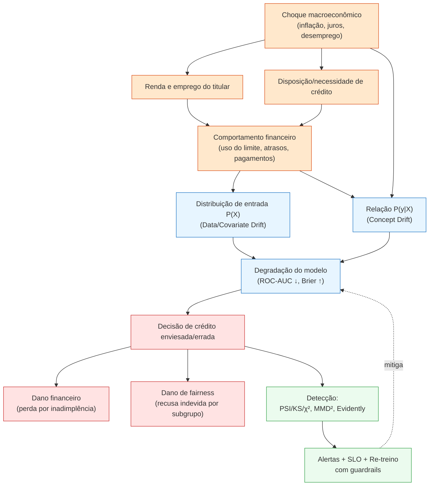

# Análise Causal — Degradação silenciosa do modelo de crédito

O DAG causal abaixo explica **por que** o modelo degrada em produção e onde o pipeline de observabilidade
atua. Ele conecta o choque macroeconômico ao dano financeiro e de fairness, passando pelo drift.

## DAG (Directed Acyclic Graph)

## Caminhos causais principais

1. **Data Drift**: `Choque macro → Renda/emprego → Comportamento (P(X) muda) → Degradação`.
   A população de produção deixa de parecer com a de treino (ex.: `LIMIT_BAL`, `AGE`, `PAY_0` deslocam).
2. **Concept Drift**: `Choque macro → P(y|X) muda` — a **relação** entre comportamento e inadimplência se
   altera (mesmo perfil, risco diferente). Não muda `P(Y)` por si só, mas o mapeamento — por isso o
   pipeline proíbe inversão aleatória de rótulos.
3. **Drift de dependência**: correlações entre features se invertem (ex.: `LIMIT_BAL × AGE`) sem alterar
   as marginais — invisível a PSI/KS, detectável por **MMD²/Energy**.

## Identificação

**Estimand**: efeito causal do choque macroeconômico (exposição) sobre a degradação do modelo, medido
por `ΔAUC_t = AUC_t(produção) − AUC_baseline`, e sobre a taxa de recusa por subgrupo (`ΔTPR_g`).

| Elemento | Definição neste projeto |
| -------- | ----------------------- |
| Tratamento | exposição ao mês `t` do choque (dose crescente; `drift.intensity × t/n`) |
| Resultado | `ΔAUC_t` (degradação) e `ΔTPR_g` (dano de fairness por subgrupo) |
| Mediador | `P(X)` e `P(y|X)` — **não** devem ser ajustados: são o mecanismo pelo qual o choque age |
| Confundidores operacionais | sazonalidade, mudança de política de crédito, rótulos atrasados, variáveis omitidas (bureau) |
| Conjunto de ajuste (backdoor) | `∅` sob exogeneidade do choque; na versão observacional, `{política de crédito, safra}` quando disponíveis |

**Por que `∅`**: o choque macro é assumido **exógeno** ao modelo (não é causado pelas decisões do
próprio modelo) e não há confundidor observado entre o choque e a degradação além dos listados. Ajustar
por `P(X)` bloquearia o caminho causal de interesse (over-control). As suposições acima são
explicitamente falsificáveis: se houver feedback loop entre decisões e comportamento, a identificação
falha — e o DAG passa a exigir modelagem dinâmica (ex.: variáveis instrumentais ou diferenças em
diferenças com carteira de controle).

**Escopo**: esta entrega é uma análise causal **descritiva** (DAG + contrafactual + suposições), não
uma estimativa numérica de efeito. O pipeline fornece a série temporal que permitiria a estimação
(interrupted time series / DiD com carteira não exposta), registrada como próximo passo.

## Suposições

- O choque macro é **exógeno** ao modelo (não é uma consequência das decisões do próprio modelo).
- As features observadas são **proxies** do comportamento financeiro subjacente.
- O rótulo `default_next_month` é medido sem viés sistemático (não há *label bias* relevante).
- Não há *feedback loop* forte de curto prazo entre decisões de crédito e o comportamento observado
  (violação desse pressuposto exigiria modelagem adicional).

## Confundidores

| Confundidor | Efeito | Mitigação |
| ----------- | ------ | --------- |
| Sazonalidade (meses de gasto) | muda `P(X)` sem mudar risco | snapshots mensais; análise temporal |
| Mudança de política de crédito | muda composição da carteira | monitorar `LIMIT_BAL` e mix de perfil |
| Rótulos atrasados (inadimplência futura) | atrasa a observação do Concept Drift | janela de avaliação por mês |
| Variáveis omitidas (score externo, bureau) | risco não explicado | documentar limites do modelo |

## Contrafactual e resposta

- **Se** o pipeline não existisse, o dano ocorreria de forma silenciosa (sem alerta) até a perda
  materializar.
- **Com** o pipeline, o drift é detectado cedo (PSI-first), consolidado em alertas anti-fadiga, o
  re-treino é acionado por regra objetiva e os guardrails de fairness bloqueiam promoção de modelos
  enviesados.
